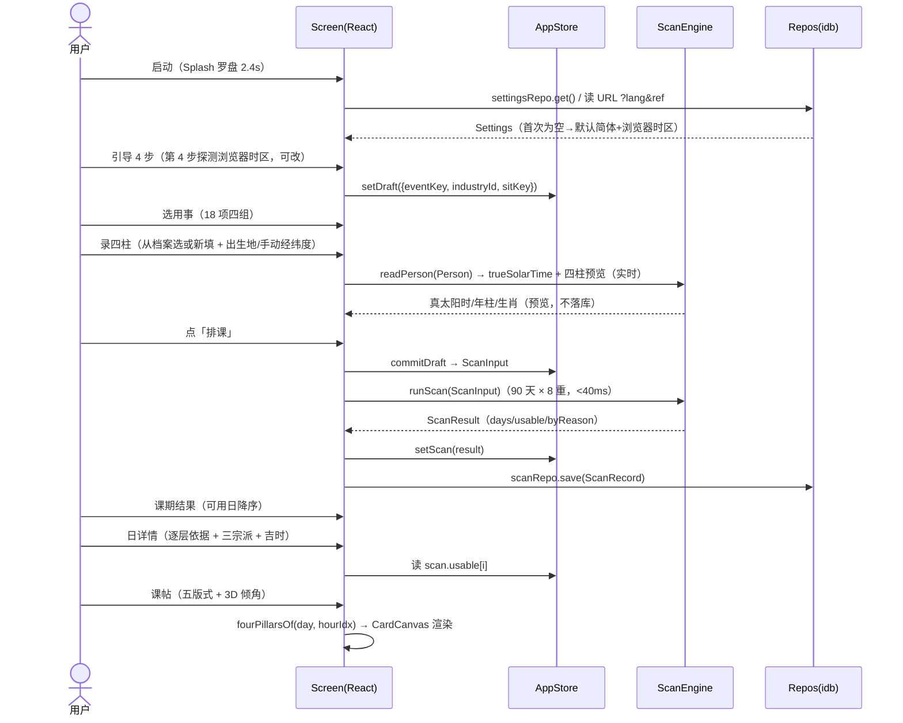
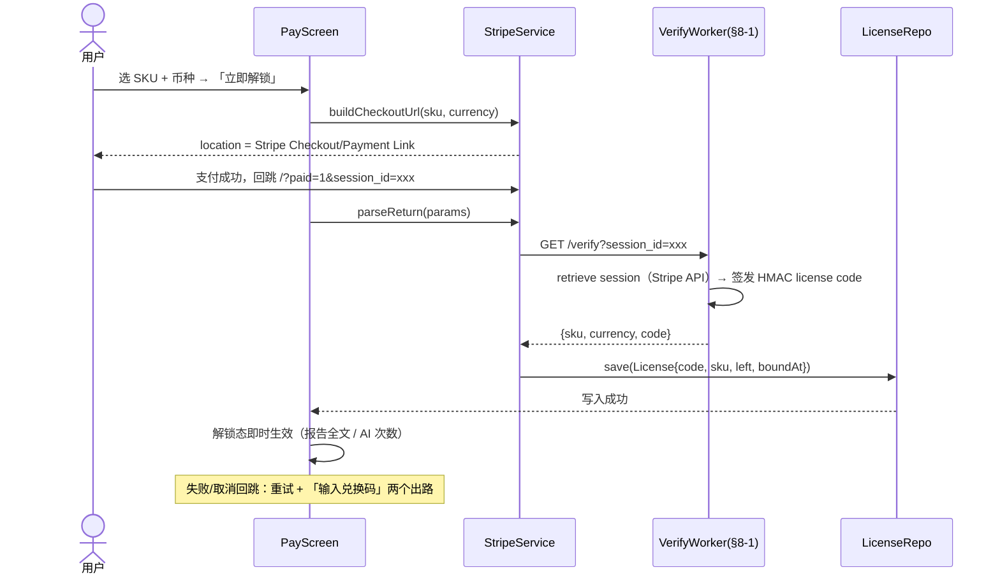
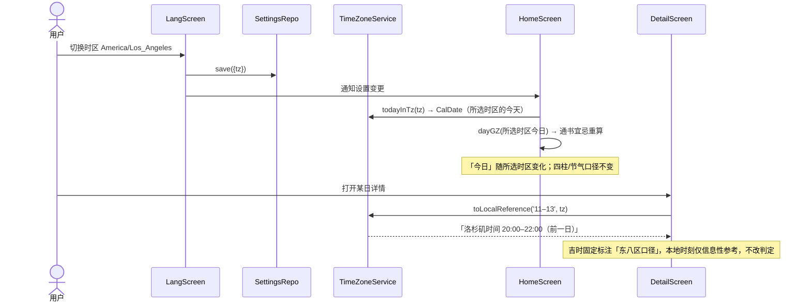
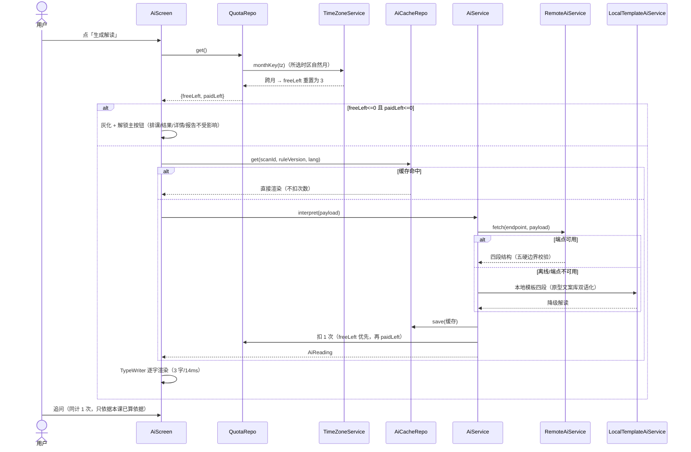

# 择吉 · 出海 H5 — 架构设计文档 + 任务分解

版本：架构 v1.0 ／ 对应《择吉 · 出海增量 PRD v1.0》与《择吉产品PRD v3.5》（规则版本 2026.10）
更新：2026.10.25 ／ 负责：架构（高见远）
工程根目录：`C:/Users/Administrator/WorkBuddy AI/2026-10-25-00-01-00/app/`（本文所有相对路径均相对该目录）

---

## 1. 实现方案与框架选型

### 1.1 核心技术难点与结论

| # | 难点 | 结论 |
|---|---|---|
| 1 | 1900–2100 年节气交接时刻，离线可用 | **运行时天文算法为主**（Meeus 太阳视黄经 + 牛顿迭代求交接时刻），仓库内置对拍数据集仅用于测试，不进 bundle。详见 §1.4 |
| 2 | 90 天 × 8 重推演 < 40ms、首屏 < 1.2s（资源内联） | 引擎纯函数零依赖；首屏 JS 预算 ≤ 180KB gzip；KB 正文/繁体包按路由懒加载；不使用 web 字体（系统衬线栈） |
| 3 | 21 屏 SPA + 方向感知屏切换动效 + 分享链接直达指定屏 | **自研屏幕栈路由**（~120 行），不用通用路由库 |
| 4 | 中英双语 + 术语表「一概念一译名」四处统一 | **自研轻量 i18n + 编译期术语联合类型**；引擎只输出结构化 reason code，文案组装只在 i18n 层 |
| 5 | 免登录、本地优先、可导出可合并、为 APP 云同步预留 | IndexedDB（`id` 封装）+ **仓库层接口抽象**，业务代码禁直接触存储 API |
| 6 | 移动端 H5 高度定制视觉（宣纸/金箔/五版课帖）+ 自研动效 | **不采用 MUI**（见 §1.3）；Tailwind 做布局原子类 + CSS 变量设计 token + ~12 个自研共享组件 |
| 7 | Stripe 一次性购买回跳写凭证、无账号 | Stripe Payment Link 为主 + 回跳解析 + 本地凭证；**核验端点见 §8 待明确事项** |

### 1.2 技术栈总表

| 层 | 选型 | 版本 | 理由 |
|---|---|---|---|
| 框架 | React + TypeScript | react@^18.3.1 / typescript@~5.5.4 | 团队默认栈；函数组件 + hooks 适配 21 屏渲染函数式原型 |
| 构建 | Vite | vite@^5.4.8 + @vitejs/plugin-react@^4.3.1 | 原生 ESM 开发、构建快、产物可内联关键 CSS |
| 样式 | Tailwind CSS | tailwindcss@^3.4.10 + postcss@^8.4.41 + autoprefixer@^10.4.20 | 布局/间距原子类；设计 token 经 `tailwind.config.ts` 映射为 theme，颜色字体一律走 CSS 变量 |
| 状态 | Zustand | zustand@^4.5.5 | ~1.2KB gz；selector 精确订阅避免 21 屏全树重渲染；persist 中间件接 Settings |
| 路由 | 自研屏幕栈（`src/router/nav.ts`） | — | 需要 push/pop/replace/tab 语义 + 380ms 方向感知 slide + `?lang&ref` 直达；通用路由器需绕行 |
| 存储 | id（IndexedDB 轻封装） | id@^8.0.0 | 实体少、均为 key/index 查找；1.2KB gz；schemaVersion 自管迁移 |
| PWA | vite-plugin-pwa（Workbox generateSW） | vite-plugin-pwa@^0.20.5 | 自动生成 manifest + Service Worker；precache 应用外壳实现离线 |
| 测试 | Vitest | vitest@^2.0.5 | 引擎纯函数单测 + 节气对拍 + 性能基准断言 |
| 二维码（P1） | qrcode-generator | @^1.4.4 | 分享落地页二维码，~10KB，无依赖 |
| 长图导出（P1） | 无依赖 | — | 课帖为 SVG 渲染 → `Image` → `canvas.toBlob` 自实现，不引 html2canvas |

**明确不采用**：MUI（+emotion 运行时约 350KB gz，默认视觉与定制设计系统冲突，动效均为自研 SVG/CSS，用不上其组件）；Redux Toolkit（过重）；react-i18next（key 松散、+15KB、无法编译期约束术语表）；date-fns/dayjs（历法计算自研，展示层用 `Intl`）；axios（原生 fetch）；任何 web 字体（系统衬线栈 `"Songti SC","Source Han Serif SC","Noto Serif SC",Georgia,serif`，与原型一致）。

### 1.3 为何不用 MUI 等重组件库（独立判断）

1. **视觉保真**：产品视觉是定制设计系统（宣纸 #F8F4EA/墨 #191710/金箔 #AF893E·#D8BC78/朱砂 #B23A2B/青瓷 #2F6B5C/南海 #0F4B46，宋体系衬线标题，五版课帖），MUI 默认皮肤需大量覆写，且 emotion 运行时注入样式与我们的 CSS 变量体系割裂。
2. **性能预算**：MUI 核心 + emotion ≈ 350KB gz，仅此一项就超过首屏 JS 预算（≤180KB gz）近一倍；海外网络首屏 <1.2s 无 CDN 兜底，必须资源内联。
3. **动效自研**：启动罗盘 2.4s、排课进度环 3.5s、课帖 3D 倾角、打字机、抽屉 360ms、横滑拖拽均为自研 SVG/CSS 动效，组件库交互组件反而要二次剥离。
4. 结论：Tailwind（布局）+ tokens.css（设计变量）+ 自研共享组件（§2 文件清单 `components/`）是体积与保真的最优解。

### 1.4 节气数据方案（重点）

**需求**：支持约 1900–2100 年节气交接时刻；离线可用；月建、年柱（立春换岁）、四离四绝依赖节气；真太阳时不依赖节气（用经度 + 均时差）。

**方案对比**：

| 维度 | A. 运行时天文算法（Meeus） | B. 内置压缩数据集 |
|---|---|---|
| 体积 | 源码 ~15KB，gzip 后 ~5KB，进 bundle | 201 年 × 24 节气 = 4824 条；Δ 编码 2B/条 ≈ 10KB，gzip ~8KB，进 bundle |
| 维护 | 零数据管线，无版本漂移 | 需生成脚本 + 可信星历源，源库停更难再生 |
| 精度 | 1900–2100 太阳视黄经误差 < 1′，交接时刻分钟级 | 取决于生成源（sxtwl/DE440s 可达秒级） |
| 风险 | 算法实现 bug | 数据损坏难排查 |
| 离线 | 满足 | 满足 |

**决策：A 为主 + B 作测试对拍（混合方案）**。

- **运行时算法**（`src/engine/calendar/solar-terms.ts`）：按 Meeus《Astronomical Algorithms》第 25 章（太阳视黄经，截断 VSOP87 级数展开）+ 第 27 章（分至点计算）实现：以年份与节气序号求近似时刻 → 牛顿迭代修正至太阳视黄经命中 15° 整数倍 → 换算为东八区民用历日期与时刻。月建判定只需**日级**精度（节气交接落在北京时间哪一天），算法分钟级精度绰绰有余；交接恰在零点的极端情形由分钟级精度保证正确归日。
- **对拍数据集**（`tests/fixtures/solar-terms-1900-2100.csv`，仅仓库内，**不进 bundle**）：4824 行 `year,termIndex,beijingDate,hh:mm`；由 `scripts/gen_solar_fixture.py`（Python + `sxtwl`，基于现代星历）离线生成一次并提交。
- **校验**：① 单测断言 24 节气逐年顺序与日序单调；② 抽样年份（每 10 年 + 全部边界年 1900/2100）与 fixture 全量对拍，误差 ≤ 1 日（时刻误差 ≤ 2 分钟记 warning 不 fail）；③ 与公开节气表（紫金山天文台）人工核对 2024–2027 年；④ 性能基准：全年 24 节气计算 < 5ms。
- **体积预算**：算法 gzip ~5KB 进 bundle；fixture ~200KB 仅 tests/。

### 1.5 历法与择日规则的计算口径与数据依赖

| 规则 | 计算口径 | 数据依赖 |
|---|---|---|
| 日柱干支 | 儒略日数 JDN 递推（`(j+49) mod 60`），纯算术，与节气无关 | 无 |
| 年柱干支 | 以**立春**交节时刻（东八区）换岁，非农历新年、非元旦 | 节气（立春） |
| 月柱干支 | 五虎遁：年干起月干；月支以**节气月**（以「节」为界，非农历初一） | 节气（12 节） |
| 时柱干支 | 五鼠遁：日干起时干；时支按两小时一时辰（子时 23:00 起） | 无 |
| 月建 / 建除十二值神 | 月建 = 节气月支；值神 =（日支 − 月建）mod 12 | 节气（12 节） |
| 女命行嫁月 | 女命年支定大利/小利/妨翁姑/妨女父母/妨夫/妨女身月；月取节气月 | 节气 + 行嫁月基数表 |
| 真太阳时 | 原始钟表时刻 + 出生地经度校正（(经度−时区×15)×4 分钟 + 均时差 EOT）；1986–1991 中国出生者先回拨夏令时 | 城市经纬度表 + EOT 算法 + 夏令时窗口表（IANA tzdata 生成，禁手抄） |
| 四离四绝 | 春分/秋分/夏至/冬至/立春/立夏/立秋/立冬各自交节**前一日** | 节气（8 节） |
| 天德/月德贵人 | 日干 × 节气月 → 查表 | 节气月 + 二德表 |
| 日课吉时 | 时支与日支成六合/三合为吉，相冲为日破 | 无（纯地支关系） |
| 日辰冲命 / 冲山 / 月害 | 地支六冲/六合/三合/相害关系 | 无 |
| 业态五行取用 | 业态五行 × 日干五行 → 比和/得气/泄气/受制/耗气 | 12 业态静态表 |

**时区双口径实现**（PRD §7.1）：引擎所有日期输入均为「东八区民用历日期」（date-only 纯函数）。「今日」的选取在 UI 层：取用户**所选时区**的当前 Y/M/D 喂给引擎；吉时展示时把东八区时段换算为所选时区作**信息性参考**并固定标注「时辰为东八区口径」。引擎不认识时区，保证可单测与可核对。

### 1.6 架构模式与边界

- **分层**：`engine/`（纯函数历法与规则，禁 DOM/fetch/Date.now，时间一律参数注入）→ `data/`（静态数据表）→ `db/`（仓库层接口 + id 实现）→ `services/`（AI/支付/时区/分享/埋点编排）→ `store/`（Zustand 会话状态）→ `screens/`+`components/`（React UI）→ `i18n/`（横切：语言包 + 术语表 + 文案组装）。
- **引擎与 UI 边界**：引擎输出 `LayerResult[]`（reason code + 参数 + 分数），**不含任何界面字符串**；人类可读文案由 `i18n/engine-text.ts` 按语言包组装。这是双语与术语统一的结构性保证。
- **仓库层抽象**：`interface Repository<T>` + `SyncableRepository<T>`（预留 `pull/push` no-op），APP 阶段切云同步只换实现。
- **导出格式即迁移协议**：`zj-backup-v1.json` 同时是 H5→APP 账号合并的 payload 格式（含 License code 列表）。

### 1.7 性能预算与部署

| 项 | 预算 |
|---|---|
| 首屏 JS（gzip） | ≤ 180KB（含引擎 ~25KB、语言包 L1 ~40KB、共享组件 ~30KB） |
| 首屏可交互 | < 1.2s（海外 4G，资源内联 + 无 web 字体 + 无第三方请求） |
| 90 天 × 8 重推演 | < 40ms（T05 基准测试断言，防回归） |
| 懒加载 | KB 正文、繁体包、课帖长图导出、二维码按需加载 |
| 部署 | 静态站点（任意 CDN / OSS）；`dist/` 产物；唯一运行时配置为 AI/Worker 端点（`.env`，可空降级为本地模板解读） |

---

## 2. 文件列表及相对路径

工程根：`app/`。每行格式：`路径 — 职责`。

### 2.1 工程配置与入口

```
app/package.json                        — 依赖声明与脚本（dev/build/test/lint）
app/tsconfig.json                       — TS 编译配置（strict，路径别名 @/*）
app/tsconfig.node.json                  — Node 侧（vite 配置）TS 配置
app/vite.config.ts                      — Vite 构建：别名、代码分割、PWA 插件、内联策略
app/tailwind.config.ts                  — Tailwind theme：设计 token → 颜色/字体/缓动映射
app/postcss.config.js                   — PostCSS（tailwind + autoprefixer）
app/.env.example                        — 运行时配置样例（AI/Worker 端点、分享主机）
app/index.html                          — SPA 外壳：meta/theme-color/启动内联关键 CSS/manifest 链接
app/public/manifest.webmanifest         — PWA 清单（名称随语言包、图标、display:standalone）
app/public/icons/icon-192.png           — PWA 图标 192（圭表 mark）
app/public/icons/icon-512.png           — PWA 图标 512（maskable）
app/public/icons/apple-touch-icon.png   — iOS 加主屏图标
app/public/og-cover.jpg                 — 分享落地页 OG 封面
app/public/robots.txt                   — 允许抓取（分享落地页可被索引）
```

### 2.2 源码 `src/`

```
src/main.tsx                            — 入口：挂载 React、注册 SW、读 URL 参数（lang/ref/paid）
src/App.tsx                             — 根组件：AppShell + 屏幕栈渲染 + 全局 Provider
src/vite-env.d.ts                       — Vite 环境变量类型声明

src/styles/tokens.css                   — 设计变量 :root（宣纸/墨/金箔/朱砂/青瓷/南海/字体/缓动，与原型一致）
src/styles/base.css                     — reset、排版、全局 keyframes（罗盘/进度环/打字机/屏切换）
src/styles/components.css               — 卡片/按钮/抽屉/课帖五版式等共享样式

src/router/nav.ts                       — 屏幕栈路由：push/pop/replace/tab、方向 dir、URL 同步
src/router/screens.ts                   — 21 屏 id 常量与 Tab 映射（与原型 SCREENS 对齐）

src/engine/types.ts                     — 引擎全部输入输出类型（CalDate/GZ/LayerResult/DayResult/ScanInput/ScanResult 等）
src/engine/calendar/julian.ts           — 公历↔儒略日数换算（日柱基准）
src/engine/calendar/sexagenary.ts       — 干支四柱：日柱、年柱（立春界）、五虎遁月柱、五鼠遁时柱
src/engine/calendar/solar-terms.ts      — Meeus 太阳视黄经 + 牛顿迭代求 24 节气交接时刻（东八区）
src/engine/calendar/equation-of-time.ts — 均时差 EOT（真太阳时校正）
src/engine/calendar/true-solar.ts       — 真太阳时：经度校正 + 夏令时回拨（1986–1991 窗口表）
src/engine/calendar/dst-china.ts        — 1986–1991 中国夏令时起止日期表（tzdata 生成，禁手抄）
src/engine/rules/relations.ts           — 地支六合/三合/相冲/相害判定
src/engine/rules/jianchu.ts             — 建除十二值神：月建日支差定值神 + 分组分值表查询
src/engine/rules/marry-month.ts         — 行嫁月：大利/小利/妨翁姑/妨女父母/妨夫/妨女身
src/engine/rules/five-phase.ts          — 五行取用四象：比和/得气/泄气/受制/耗气
src/engine/rules/virtues.ts             — 天德/月德贵人查表
src/engine/rules/li-jue.ts              — 四离四绝：八节交节前一日判定
src/engine/rules/hours.ts               — 日课吉时：十二时辰 × 日支 → 六合/三合/日破
src/engine/scoring/layers.ts            — 八重逐层计分：产出 LayerResult[]（reason code + delta + cls）
src/engine/scoring/score.ts             — score=clamp(60+Σ,30,99)、出局阈值 80、四级评定
src/engine/scoring/generic.ts           — 通用模式 4 重（未录四柱）计分
src/engine/schools.ts                   — 三宗派对照：行嫁月派/不将日派/建除派并列与取法建议
src/engine/scan.ts                      — 排课入口 runScan/scanGeneric：区间逐日推演 + 出局归因聚合
src/engine/pillars.ts                   — 日课四柱组装（年/月/日/时柱，供报告与课帖）
src/engine/render/reading.ts            — 「下一个可用日」等引擎派生查询（首页/仪程用）

src/data/events.ts                      — 18 用事四组（key/组别/所须/关键动作/取用核心）
src/data/industries.ts                  — 12 业态（门类/五行/细分/关键动作/行业典籍/要点）
src/data/jc-tables.ts                   — 建除分组分值表 + 十二值神专业释义（术语固化）
src/data/sits.ts                        — 坐向 8 向（子山午向等，zhi 索引）
src/data/cities.ts                      — 城市经纬度表：国内 24 城 + 海外约 40 城（预填时区仅显示）
src/data/books.ts                       — 25 部典籍索引（类别/作者/提要）
src/data/kb.ts                          — 知库 24 篇元数据（分类/时长/典籍标注）
src/data/kb-bodies.ts                   — 知库长文正文（中文，按需懒加载分片）
src/data/kb-bodies-en.ts                — 知库长文英译（P1 首批 10 篇，缺失篇目标识「中文原文」）
src/data/prices.ts                      — 四 SKU × 五币种价格表 + Stripe Payment Link 模板
src/data/todos.ts                       — 仪程倒排四组清单
src/data/holidays.ts                    — 节庆参考标记表（P1，按地区；不进计分）

src/i18n/types.ts                       — Lang/TermKey/MsgKey 联合类型（编译期约束术语表）
src/i18n/glossary.ts                    — 术语表：一概念一译名（zh/en/zh-Hant 三列，含双轨格式）
src/i18n/zh.ts                          — 简体中文语言包（L1 界面 + L2 交付物 + 引擎 reason code 文案）
src/i18n/en.ts                          — 英文语言包（对齐术语表，结果性词汇红线）
src/i18n/zh-hant.ts                     — 繁体中文语言包（P1）
src/i18n/index.ts                       — t()/term()/setLang/getLang 实现与当前语言响应式
src/i18n/format.ts                      — Intl 日期/数字本地化（日期格式随地区、干支并排公元）
src/i18n/engine-text.ts                 — 引擎 LayerResult → 人类可读逐层依据（唯一文案组装处）

src/db/idb.ts                           — id 实例 + schemaVersion 迁移 + localStorage 降级探测
src/db/types.ts                         — 八实体 + License + Settings 的存储类型（含 schemaVersion）
src/db/repos/person.repo.ts             — 当事人档案 CRUD（按 personId）
src/db/repos/scan.repo.ts               — 课期历史存读（Scan 快照）
src/db/repos/favorite.repo.ts           — 收藏吉日
src/db/repos/license.repo.ts            — 购买凭证（code/sku/left/boundAt）
src/db/repos/quota.repo.ts              — AI 配额（freeLeft/monthKey/paidLeft，monthKey 按时区月）
src/db/repos/settings.repo.ts           — 设置（语言/时区/币种/历法显示）
src/db/repos/ai-cache.repo.ts           — AI 解读本机缓存（scanId+ruleVersion+lang 键）
src/db/backup.ts                        — 导出/导入 zj-backup-v1.json：按 personId 去重合并

src/services/timezone.ts                — 所选时区工具：今日选取、东八区→本地参考换算、时区月 key
src/services/ai/ai-service.ts           — AI 解读接口 + 配额/缓存编排（Remote/Local 双实现切换）
src/services/ai/remote-ai.ts            — RemoteAiService：fetch 推理端点（§8 待明确），输出五硬边界校验
src/services/ai/local-template-ai.ts    — LocalTemplateAiService：离线模板四段解读（原型文案库双语化）
src/services/pay/stripe.ts              — Payment Link/Checkout URL 构造 + 回跳参数解析
src/services/pay/redeem.ts              — 兑换码离线校验（HMAC）+ 写入凭证
src/services/share.ts                   — 分享链接（lang/ref）+ 二维码（P1）+ 长图导出（P1）
src/services/analytics.ts               — 匿名埋点：本机事件队列 + 可选 beacon（P1）

src/store/app-store.ts                  — Zustand：导航栈、当前课期草稿、scan 会话、AI 会话态
src/store/settings-store.ts             — Zustand：语言/时区/币种/历法（persist → settings.repo）
src/store/ui-store.ts                   — 轻 UI 态：抽屉/toast/横滑分类（不持久化）

src/components/AppShell.tsx             — 手机外壳：状态栏/屏幕容器/380ms 方向感知切换动画
src/components/TabBar.tsx               — 底部 5 Tab（今日/择日/报告/知库/我的）
src/components/AppBar.tsx               — 顶部返回栏 + 标题 + 右侧动作
src/components/Sheet.tsx                — 底部抽屉 360ms + backdrop（宜忌口径/典籍/分享等）
src/components/Logo.tsx                 — 圭表测影 SVG（mark/lockup/mono 三型，小尺寸加粗补偿）
src/components/CompassIntro.tsx         — 启动罗盘 2.4s 三层反向旋转 + 品牌淡入
src/components/ScanRing.tsx             — 排课进度环 3.5s：stroke-dashoffset + 逐重点亮 440ms/重
src/components/CardCanvas.tsx           — 课帖五版式骨架 + 3D 倾角 ±9° + 长图导出
src/components/TypeWriter.tsx           — 打字机（3 字/14ms，保留 HTML 标签）
src/components/Ring.tsx                 — 课格评分圆环
src/components/Seg.tsx                  — 分段控件（组别/页签/币种）
src/components/Chip.tsx                 — 胶囊标签（口径标注/支付方式）
src/components/Btn.tsx                  — 主/次/幽灵按钮 + 底部固定主按钮
src/components/EmptyState.tsx           — 空态四原则组件（归因 + 出路）
src/components/ScrollX.tsx              — 分类横滑：指针 1:1 拖拽 + 两端渐隐 + 金色进度条
src/components/LayerRow.tsx             — 日详情逐层依据行（手风琴 320ms）

src/screens/SplashScreen.tsx           — 启动屏：罗盘 + 品牌 lockup（随语言包）
src/screens/OnboardScreen.tsx          — 引导 4 步（通书 vs 你的/三元/交付物/业态）+ 时区探测
src/screens/HomeScreen.tsx              — 今日首页：通书宜忌 + 口径胶囊 + 抽屉对比表
src/screens/EventScreen.tsx             — 用事 18 项四组选择
src/screens/InfoScreen.tsx              — 录四柱：表单 + 出生地 40 城 + 手动经纬度 + 四柱预览 + 通用模式入口
src/screens/PeopleScreen.tsx            — 当事人档案列表（选用态/本课在用/真太阳时）
src/screens/PeopleFormScreen.tsx        — 当事人新增/编辑表单（校验 + 实时四柱预览 + 删除二次确认）
src/screens/CalcScreen.tsx              — 排课动效屏（进度环 + 逐层点亮 → 自动进结果）
src/screens/ResultScreen.tsx            — 课期结果：可用日列表/分数/无可用日归因空态
src/screens/DetailScreen.tsx            — 日详情：四柱/逐层依据/三宗派/吉时（东八标注 + 本地参考）
src/screens/CardScreen.tsx              — 吉日课帖五版式切换 + 导出长图
src/screens/PayScreen.tsx               — 解锁支付页：SKU×币种/Stripe 跳转/兑换码/配额卡
src/screens/ReportsScreen.tsx           — 课期档案（本机凭证判定解锁态）
src/screens/ReportScreen.tsx            — 九章报告（结论/适配/四柱/清单/归因/时点/节奏/AI/免责）
src/screens/AiScreen.tsx                — AI 解读：配额条/四段结构/追问/打字机
src/screens/KbScreen.tsx                — 知库：按业态分类横滑 + 典籍抽屉
src/screens/ArticleScreen.tsx           — 长文详情（未英译篇目标识）
src/screens/FavScreen.tsx               — 收藏吉日夹
src/screens/MeScreen.tsx                — 我的：本机数据与设置（无任何登录入口）
src/screens/LangScreen.tsx              — 语言与地区：语言/历法/时区/币种四区
src/screens/RemindScreen.tsx            — 仪程倒排：倒计时 + 清单 + .ics 导出
src/screens/ShareLandScreen.tsx         — 分享落地页（?lang&ref + 二维码 + 直达引导第 2 步）

src/lib/result.ts                       — Result<T> 与错误码约定（引擎/服务层不抛异常）
src/lib/storage-fallback.ts             — IndexedDB 不可用时的 localStorage 降级
```

### 2.3 测试与脚本

```
tests/engine/julian.test.ts             — JDN 对拍（已知历史日期）
tests/engine/sexagenary.test.ts         — 四柱可人工验算用例（含立春换岁边界）
tests/engine/solar-terms.test.ts        — 节气算法 vs fixture 对拍 + 顺序/边界断言
tests/engine/true-solar.test.ts         — 真太阳时 + 夏令时回拨用例（含海外经度）
tests/engine/scoring.test.ts            — 八重计分黄金用例（PRD §7.3 的 11/80 实测复现）
tests/engine/scan.bench.ts              — 性能基准：90 天 × 8 重 < 40ms 断言
tests/db/repos.test.ts                  — 仓库层 CRUD（fake-indexeddb）
tests/db/backup.test.ts                 — 导出/导入合并：personId 去重、License 携带
tests/i18n/glossary.test.ts             — 术语表完整性：三语 key 对齐、无同概念两译名
scripts/gen_solar_fixture.py            — 节气对拍数据集生成（Python + sxtwl，仅开发期）
```

---

## 3. 数据结构和接口

### 3.1 核心类型定义（对齐 PRD v3.5 §13 六实体 + License + Settings + 引擎输入输出）

```ts
// ============ 基础历法类型（engine/types.ts） ============
export interface CalDate { y: number; m: number; d: number }        // 东八区民用历日期（date-only）
export interface GZ { gan: number; zhi: number; index: number; text: string } // 干支，index 为六十甲子序
export interface FourPillars { year: string; month: string; day: string; hour: string }
export type Lang = 'zh' | 'en' | 'zh-Hant';

// ============ 当事人档案 Person（db/types.ts） ============
export interface Person {
  id: string;                    // personId（uuid）
  schemaVersion: number;         // 记录级版本（全局跳过 4）
  name: string;                  // 称呼（必填）
  sex: 'f' | 'm';                // 决定取月用女命或男命
  birthDate: string;             // 原始钟表日期 'YYYY-MM-DD'（出生地本地历）
  birthTime: string;             // 原始钟表时刻 'HH:mm'（出生地本地钟表，未经校正）
  birthCityId: string | null;    // 城市表 id；null 表示手动经纬度
  manualLon?: number;            // 手动经纬度兜底（城市不在列表时）
  manualLat?: number;
  dstAdjusted?: boolean;         // 1986–1991 中国出生：档案已标注夏令时，读取时回拨
  note?: string;                 // 备注
  createdAt: number;             // ISO 8601 UTC
}
// 注意：档案只存原始钟表时刻 + 出生地；真太阳时与四柱每次读取时重算，禁存结果。

// ============ 业态 Industry / 用事 Event（data/*.ts，静态表） ============
export interface Industry {
  id: string; name: TermKey;        // 名称走术语表
  category: TermKey;                // 所属门类（界面不显示代码字母）
  wuxing: 0|1|2|3|4;                // 木火土金水
  subs: TermKey[]; acts: TermKey[]; // 细分业态 / 关键动作
  books: string[]; note: TermKey;   // 行业典籍 / 业态要点
}
export type EventGroup = '经营择日'|'工程择日'|'家庭择日'|'生命礼';
export interface EventDef {
  key: string; group: EventGroup; name: TermKey; sub: TermKey;
  need: TermKey; acts: TermKey[]; core: TermKey; // 取用核心
  layers: 7 | 8; twoPerson: boolean;              // 家庭 7 重 / 经营工程 8 重；嫁娶订婚须双方
}

// ============ 引擎输入输出（engine/types.ts） ============
export type LayerKey =
  | 'marryMonth' | 'monthBranch' | 'jianchu' | 'industryWuxing'
  | 'sittingFacing' | 'monthHarm' | 'dayClashYear' | 'liJue'
  | 'virtues' | 'goodHours';
export type LayerCls = 'ok' | 'warn' | 'bad';
export interface LayerResult {           // 引擎只出 reason code，不出界面字符串
  key: LayerKey; resultKey: string;      // 如 'jc.po'、'wx.deqi'
  params?: Record<string, string | number>; // 文案组装参数（日支、生肖、分值…）
  cls: LayerCls; delta: number;
}
export type HardReason = 'yuepo' | 'chongming' | 'chongshan' | 'lijue' | 'fangfu';
export type Grade = 'shangji' | 'zhongji' | 'keyong' | 'buyong'; // 上吉/中吉/可用/不用
export interface HourMark { index: number; name: string; range: string; mark: 'liuhe'|'sanhe'|'po'|'ping'; cls: LayerCls }
export interface DayResult {
  date: CalDate; weekday: number;
  dayGZ: GZ; monthZhi: number; monthName: string; jieqi: string;
  jianchu: string; pillars: FourPillars;
  layers: LayerResult[]; score: number; grade: Grade;
  hard: HardReason | null; eligible: boolean; reasonKey: string; // 'reason.scoreLow' 等
  hours: HourMark[]; goodHours: HourMark[];
}
export interface ScanInput {
  eventKey: string; people: Person[]; industryId?: string; sitKey?: string;
  startDate: CalDate; span: number;          // 默认 90 天
  generic?: boolean;                          // 通用模式（未录四柱，4 重）
  school?: 'xingjia' | 'bujiang' | 'jianchu';
}
export interface ScanResult {
  input: ScanInput; days: DayResult[]; usable: DayResult[];
  byReason: Record<string, number>;          // 出局归因计数
  total: number; generic: boolean;
  ruleVersion: string;                       // '2026.10'
  createdAt: number;                         // ISO 8601 UTC
}

// ============ 其余业务实体（db/types.ts） ============
export interface ScanRecord { id: string; scan: ScanResult; unlocked: boolean; schemaVersion: number }
export interface Favorite { id: string; personId: string | null; date: CalDate; eventKey: string; note?: string; createdAt: number }
export type Sku = 'once' | 'ai10' | 'pair' | 'year';
export interface License {
  code: string; sku: Sku; left: number;      // left: ai10=次数；once/pair=1；year=-1 表示不限
  currency: 'CNY'|'USD'|'SGD'|'MYR'|'THB';
  boundAt: number; migrated: boolean;        // APP 阶段 code 可迁移一次
  schemaVersion: number;
}
export interface AiQuota { freeLeft: number; monthKey: string; paidLeft: number; used: number; schemaVersion: number }
export interface Settings {
  lang: Lang; tz: string;                    // IANA 时区，默认浏览器探测
  currency: keyof typeof PRICE_TABLE; cals: Array<'greg'|'buddhist'|'ganzhi'|'lunar'>;
  schemaVersion: number;
}
```

### 3.2 引擎纯函数签名（全部 date-in/result-out，禁 DOM、禁 Date.now）

```ts
// engine/calendar/solar-terms.ts
export function solarTermMoment(year: number, termIndex: number): { date: CalDate; minutes: number } // 东八区民用历
export function termIndexOfDate(d: CalDate): { index: number; name: TermKey; monthZhi: number }
export function isBeforeTerm(d: CalDate, termIndex: number): boolean   // 四离四绝用：是否交节前一日
// engine/calendar/sexagenary.ts
export function dayGZ(d: CalDate): GZ                    // JDN 递推
export function yearGZ(d: CalDate): GZ                   // 立春换岁
export function monthGZ(yearGanIdx: number, monthZhi: number): string  // 五虎遁
export function hourGZ(dayGanIdx: number, hourZhi: number): string     // 五鼠遁
// engine/calendar/true-solar.ts
export function trueSolarTime(birth: { y:number;m:number;d:number;hh:number;mm:number; lon:number; tz:number; dst:boolean }):
  { h: number; m: number; dayShift: -1|0|1; offsetMin: number }
// engine/scan.ts —— 排课入口
export function runScan(input: ScanInput): ScanResult    // 90 天 × 8 重，目标 < 40ms
export function scanGeneric(input: ScanInput): ScanResult // 通用模式 4 重
// engine/scoring/layers.ts —— 逐层计分
export function scoreLayers(d: CalDate, people: Person[], ev: EventDef, industry?: Industry, sit?: string): LayerResult[]
// engine/rules/*.ts
export function jianchuOf(d: CalDate): { name: string; index: number; points: number }
export function marryMonth(womanZhi: number, monthZhi: number): { level: 'good'|'ok'|'warn'|'bad'|'bad2'; hard?: boolean }
export function wuxingRelation(industryWx: number, dayGanWx: number): 'bihe'|'deqi'|'xieqi'|'shouzhi'|'haoqi'
export function hoursOf(dayZhi: number): HourMark[]
export function fourPillarsOf(day: DayResult, hourIdx?: number): FourPillars
// engine/schools.ts —— 三宗派对照
export function schoolReadings(day: DayResult, school: ScanInput['school']): Array<{ school: TermKey; score: number; note: TermKey }>
export function schoolAdvice(readings: SchoolReading[]): 'consistent' | 'conservative' | 'aggressive'
```

### 3.3 存储仓库层接口（为 APP 云同步预留）

```ts
// db/repos/*.ts 统一实现自：
export interface Repository<T extends { id: string }> {
  get(id: string): Promise<T | null>;
  save(entity: T): Promise<void>;
  list(): Promise<T[]>;
  remove(id: string): Promise<void>;
}
// APP 阶段云同步预留（H5 为 no-op 实现）：
export interface SyncableRepository<T extends { id: string }> extends Repository<T> {
  pull(): Promise<T[]>;   // H5: 返回 []
  push(all: T[]): Promise<void>; // H5: no-op
}
// backup.ts —— 导出/导入（H5→APP 迁移协议）
export interface BackupV1 {
  format: 'zj-backup-v1'; exportedAt: number; ruleVersion: string;
  people: Person[]; scans: ScanRecord[]; favorites: Favorite[]; licenses: License[];
}
export function exportBackup(): Promise<BackupV1>
export function importBackup(raw: unknown): Promise<{ people: number; merged: number; licenses: number }> // 按 personId 去重合并
```

### 3.4 语言包与术语表数据结构

```ts
// i18n/types.ts —— 编译期约束：概念唯一 key
export type TermKey = 'term.zeji' | 'term.tongshu' | 'term.jianchu' | 'term.yuejian' | /* …全部择日术语 */
export type MsgKey = 'home.yi' | 'home.ji' | 'reason.scoreLow' | /* …全部界面文案 + 引擎 reason code */
// i18n/glossary.ts —— 一概念一译名，四处（界面/报告/AI/知库标题）共用
export interface GlossaryEntry { key: TermKey; zh: string; en: string; zhHant: string; pinyin?: string; note?: string }
export const GLOSSARY: GlossaryEntry[] = [ /* PRD §2.3 首批 24 条起，随版本扩充 */ ]
// i18n/zh.ts / en.ts —— 语言包：MsgKey → 字符串（支持 {param} 插值）
export type Messages = Record<MsgKey, string>;
// i18n/index.ts
export function t(key: MsgKey, params?: Record<string, string|number>): string
export function term(key: TermKey): string      // 术语表查询（英文双轨格式由条目自带）
export function setLang(lang: Lang): void       // 即时生效，无需刷新
```

### 3.5 类图

```mermaid
classDiagram
  class CalDate {
    +number y
    +number m
    +number d
  }
  class GZ {
    +number gan
    +number zhi
    +number index
    +string text
  }
  class Person {
    +string id
    +string name
    +string sex
    +string birthDate
    +string birthTime
    +string birthCityId
    +number manualLon
    +boolean dstAdjusted
    +number createdAt
  }
  class Industry {
    +string id
    +TermKey name
    +number wuxing
    +TermKey[] acts
    +string[] books
  }
  class EventDef {
    +string key
    +EventGroup group
    +TermKey name
    +TermKey[] acts
    +number layers
    +boolean twoPerson
  }
  class LayerResult {
    +LayerKey key
    +string resultKey
    +Record params
    +LayerCls cls
    +number delta
  }
  class HourMark {
    +number index
    +string name
    +string range
    +string mark
    +LayerCls cls
  }
  class DayResult {
    +CalDate date
    +GZ dayGZ
    +number monthZhi
    +string jianchu
    +FourPillars pillars
    +LayerResult[] layers
    +number score
    +Grade grade
    +HardReason hard
    +boolean eligible
    +HourMark[] goodHours
  }
  class ScanInput {
    +string eventKey
    +Person[] people
    +string industryId
    +string sitKey
    +CalDate startDate
    +number span
    +boolean generic
    +string school
  }
  class ScanResult {
    +ScanInput input
    +DayResult[] days
    +DayResult[] usable
    +Record byReason
    +string ruleVersion
  }
  class License {
    +string code
    +Sku sku
    +number left
    +string currency
    +boolean migrated
  }
  class AiQuota {
    +number freeLeft
    +string monthKey
    +number paidLeft
  }
  class Settings {
    +Lang lang
    +string tz
    +string currency
    +string[] cals
  }

  class SolarTerms {
    +solarTermMoment(year, termIndex) CalDate
    +termIndexOfDate(d) object
  }
  class SexagenaryCycle {
    +dayGZ(d) GZ
    +yearGZ(d) GZ
    +monthGZ(gan, zhi) string
    +hourGZ(gan, zhi) string
  }
  class TrueSolarTime {
    +trueSolarTime(birth) object
  }
  class ScoringEngine {
    +scoreLayers(d, people, ev, industry, sit) LayerResult[]
    +computeScore(layers) number
  }
  class ScanEngine {
    +runScan(input) ScanResult
    +scanGeneric(input) ScanResult
  }
  class SchoolComparator {
    +schoolReadings(day, school) SchoolReading[]
    +schoolAdvice(readings) string
  }

  class I18nService {
    +t(key, params) string
    +term(key) string
    +setLang(lang) void
  }
  class TimeZoneService {
    +todayInTz(tz) CalDate
    +toLocalReference(rangeBeijing, tz) string
    +monthKey(tz) string
  }
  class AiService {
    <<interface>>
    +interpret(payload) AiReading
  }
  class RemoteAiService
  class LocalTemplateAiService
  class StripeService {
    +buildCheckoutUrl(sku, currency) string
    +parseReturn(params) object
  }
  class RedeemService {
    +verifyCode(code) License
  }
  class BackupService {
    +exportBackup() BackupV1
    +importBackup(raw) object
  }
  class AnalyticsService {
    +track(event, props) void
  }

  class Repository~T~ {
    <<interface>>
    +get(id) T
    +save(entity) void
    +list() T[]
    +remove(id) void
  }
  class PersonRepository
  class ScanRepository
  class FavoriteRepository
  class LicenseRepository
  class QuotaRepository
  class SettingsRepository
  class AiCacheRepository
  class AppStore {
    +ScreenId current
    +push(id) void
    +pop() void
  }

  ScanEngine --> SolarTerms
  ScanEngine --> SexagenaryCycle
  ScanEngine --> ScoringEngine
  ScanEngine --> SchoolComparator
  ScoringEngine --> TrueSolarTime
  ScoringEngine ..> LayerResult : produces
  ScanResult *-- DayResult
  DayResult *-- LayerResult
  DayResult *-- HourMark
  DayResult *-- GZ
  ScanInput *-- Person
  ScanResult *-- ScanInput
  AiService <|.. RemoteAiService
  AiService <|.. LocalTemplateAiService
  AiService --> QuotaRepository
  AiService --> AiCacheRepository
  StripeService --> LicenseRepository
  RedeemService --> LicenseRepository
  BackupService --> PersonRepository
  BackupService --> ScanRepository
  BackupService --> LicenseRepository
  Repository <|.. PersonRepository
  Repository <|.. ScanRepository
  Repository <|.. FavoriteRepository
  Repository <|.. LicenseRepository
  Repository <|.. QuotaRepository
  Repository <|.. SettingsRepository
  Repository <|.. AiCacheRepository
  AppStore --> Repository
  I18nService ..> GLOSSARY : reads
```



---

## 4. 程序调用流程

### 4.1 主流程：首启引导 → 选用事 → 录四柱 → 排课 → 结果 → 详情 → 课帖



### 4.2 Stripe 购买回跳写凭证



### 4.3 时区切换对「今日」与吉时标注的影响



### 4.4 AI 解读配额与缓存



---

## 5. 任务列表（按实现顺序，共 32 个）

> 规模：S ≈ ≤1 人日，M ≈ 2–3 人日，L ≈ 4–5 人日。优先级 P0 = 出海首版必须，P1 = 首版后一个迭代。

### T01 工程脚手架 — P0 · S
- **目标**：可运行的空应用 + 设计 token + PWA 外壳 + 目录骨架。
- **文件**：`package.json`、`vite.config.ts`、`tailwind.config.ts`、`postcss.config.js`、`tsconfig*.json`、`index.html`、`.env.example`、`src/main.tsx`、`src/App.tsx`、`src/styles/tokens.css`、`src/styles/base.css`、`src/vite-env.d.ts`、`public/manifest.webmanifest`、`public/icons/*`
- **依赖**：无
- **验收**：`npm run dev` 起服；tokens.css 变量与原型 `:root` 逐值一致；Tailwind theme 引用 CSS 变量；构建产物 gzip 首屏 < 300KB（空壳）。

### T02 引擎 · 历法基座 — P0 · M
- **目标**：JDN/干支/节气算法/均时差/真太阳时，纯函数可单测。
- **文件**：`src/engine/types.ts`、`src/engine/calendar/julian.ts`、`sexagenary.ts`、`solar-terms.ts`、`equation-of-time.ts`、`true-solar.ts`、`dst-china.ts`、`tests/engine/julian.test.ts`、`tests/engine/sexagenary.test.ts`、`tests/engine/solar-terms.test.ts`、`tests/engine/true-solar.test.ts`、`scripts/gen_solar_fixture.py`
- **依赖**：T01
- **验收**：四柱用例可人工验算（五虎遁/五鼠遁、立春换岁边界）；节气与 fixture 对拍抽样年误差 ≤1 日；温哥华/北京经度差校正量正确；1986–1991 夏令时回拨正确。

### T03 引擎 · 规则层 — P0 · M
- **目标**：八重取值所需全部原子规则。
- **文件**：`src/engine/rules/relations.ts`、`jianchu.ts`、`marry-month.ts`、`five-phase.ts`、`virtues.ts`、`li-jue.ts`、`hours.ts`、`src/data/jc-tables.ts`、`src/data/sits.ts`
- **依赖**：T02
- **验收**：建除分组分值表与原型逐值一致；行嫁月六级（大利/小利/妨翁姑/妨女父母/妨夫/妨女身）与口诀表一致；四离四绝为八节前一日；吉时六合/三合/日破判定正确。

### T04 引擎 · 计分与排课 — P0 · M
- **目标**：八重计分、clamp/阈值/四级、通用模式、三宗派、排课入口。
- **文件**：`src/engine/scoring/layers.ts`、`score.ts`、`generic.ts`、`src/engine/schools.ts`、`src/engine/scan.ts`、`src/engine/pillars.ts`、`src/engine/render/reading.ts`、`tests/engine/scoring.test.ts`、`tests/engine/scan.bench.ts`
- **依赖**：T03
- **验收**：复现 PRD §7.3 实测：开业开市·餐饮·坐北朝南 90 天 11 可用日、通用模式 80 可用日；score=clamp(60+Σ,30,99)、阈值 80；硬性出局五类任一命中即出局；90 天 × 8 重 < 40ms（基准断言）。

### T05 静态数据表 — P0 · M
- **目标**：12 业态/18 用事/50+ 城/25 典籍/24 篇知库/价格表/仪程表集中落地。
- **文件**：`src/data/events.ts`、`industries.ts`、`cities.ts`、`books.ts`、`kb.ts`、`kb-bodies.ts`、`prices.ts`、`todos.ts`（`holidays.ts` 留 P1）
- **依赖**：T01
- **验收**：18 用事四组、家庭 7 重/经营工程 8 重标注齐全；12 业态五行/关键动作/典籍与 v3.5 §05 一致；城市表含 PRD §7.2 海外 40 城且经度正确；价格表与 PRD §4.1 五币种逐值一致；知库 24 篇分类/典籍标注齐全。

### T06 i18n 框架与术语表 — P0 · M
- **目标**：轻量 i18n + 编译期术语约束 + 三语骨架。
- **文件**：`src/i18n/types.ts`、`glossary.ts`、`index.ts`、`format.ts`、`zh.ts`、`en.ts`、`zh-hant.ts`、`tests/i18n/glossary.test.ts`
- **依赖**：T01
- **验收**：`t(key, params)` 插值与语言切换即时生效（无刷新）；术语表三语 key 完全对齐、无同概念两译名；英文双轨格式（拼音 + 释义）可配置；日期格式随地区（美式月/日/年）。

### T07 引擎文案组装（双语 reason code） — P0 · M
- **目标**：LayerResult → 逐层依据中英双语，唯一文案组装处。
- **文件**：`src/i18n/engine-text.ts`（改）、`src/i18n/zh.ts`（改）、`src/i18n/en.ts`（改）、`src/i18n/types.ts`（改）
- **依赖**：T04、T06
- **验收**：八重 + 通用模式全部 LayerResult 有中英案；报告/详情/AI/知库标题四处术语一致；英文界面整屏无中文字段残留（专有名词除外）。

### T08 存储层 · 仓库抽象 — P0 · M
- **目标**：id 实例 + 七仓库 + schemaVersion 迁移 + localStorage 降级。
- **文件**：`src/db/idb.ts`、`types.ts`、`repos/person.repo.ts`、`scan.repo.ts`、`favorite.repo.ts`、`license.repo.ts`、`quota.repo.ts`、`settings.repo.ts`、`ai-cache.repo.ts`、`src/lib/storage-fallback.ts`、`tests/db/repos.test.ts`
- **依赖**：T01
- **验收**：CRUD 全通过（fake-indexeddb）；IndexedDB 不可用时降级 localStorage 且功能不阻断；每条记录带 schemaVersion；仓库接口含 `SyncableRepository` 预留（pull/push no-op）。

### T09 状态管理与导航骨架 — P0 · M
- **目标**：Zustand 三 store + 屏幕栈路由 + AppShell/TabBar + 380ms 方向感知切换。
- **文件**：`src/store/app-store.ts`、`settings-store.ts`、`ui-store.ts`、`src/router/nav.ts`、`screens.ts`、`src/components/AppShell.tsx`、`TabBar.tsx`、`AppBar.tsx`
- **依赖**：T01
- **验收**：push/pop/replace/tab 语义正确、返回方向感知；Tab 五态高亮；设置持久化到 settings.repo；URL 可同步（分享链接直达）。

### T10 共享组件库 — P0 · M
- **目标**：Logo/CompassIntro/ScanRing/CardCanvas/TypeWriter/Sheet/Ring/Seg/Chip/Btn/EmptyState/ScrollX/LayerRow。
- **文件**：`src/components/*.tsx`（上述 13 个）、`src/styles/components.css`
- **依赖**：T09
- **验收**：动效参数与原型一致（罗盘 2.4s/进度环 3.5s 每重 440ms/抽屉 360ms/打字机 3 字 14ms/横滑 1:1）；Logo 20/26/34/96 四档清晰、小尺寸省略外环加粗描边；课帖五版式骨架同内容换 CSS 变量与装饰层；3D 倾角 ±9°。

### T11 启动屏 + 引导 4 步 — P0 · S
- **文件**：`src/screens/SplashScreen.tsx`、`OnboardScreen.tsx`（改组件复用 T10）
- **依赖**：T10
- **验收**：罗盘三层反向旋转 + 地支刻点 + 品牌淡入 2.4s；副标随语言包（英文 "Three-Factor Date Selection"）；4 步均可前进/跳过，跳过直达首页；第 4 步探测浏览器时区提示可改。

### T12 首页 · 今日屏 — P0 · M
- **文件**：`src/screens/HomeScreen.tsx`、`src/components/Sheet.tsx`（如未在 T10 完成则并入）、`src/services/timezone.ts`
- **依赖**：T10、T06
- **验收**：通书宜忌按**所选时区**判定「今日」；「通书宜忌 · 通用口径」胶囊 + 抽屉六行对比表 + 主按钮直达用事页；宜忌口径标注双语；历法显示按 Settings。

### T13 用事 18 项屏 — P0 · S
- **文件**：`src/screens/EventScreen.tsx`、`src/components/Seg.tsx`（复用）
- **依赖**：T10、T05
- **验收**：四组 18 项呈现；切换用事课格层数（7/8）与计分表联动预览；嫁娶/订婚标记「须双方」。

### T14 录四柱屏 — P0 · M
- **文件**：`src/screens/InfoScreen.tsx`、`src/data/cities.ts`（接线）
- **依赖**：T10、T05、T02
- **验收**：出生地选择器含海外 40 城预填经度；「不在列表」手动经纬度入口带格式校验 + 实时四柱预览；真太阳时重算而非存结果；「不填生辰也能看」入口 → 通用模式；表单实时四柱预览。

### T15 当事人档案（列表/表单/选用） — P0 · M
- **文件**：`src/screens/PeopleScreen.tsx`、`PeopleFormScreen.tsx`、`src/db/repos/person.repo.ts`（接线）
- **依赖**：T14、T08
- **验收**：增（称呼必填校验）/改（回填 + 四柱预览）/删（二次确认）/选用（回填四柱页）；列表显示真太阳时/属相/年柱/「本课在用」；空态「还没有当事人」+ 出路；嫁娶提示须录双方。

### T16 排课屏 — P0 · S
- **文件**：`src/screens/CalcScreen.tsx`、`src/components/ScanRing.tsx`（接线）
- **依赖**：T10、T04
- **验收**：进度环 stroke-dashoffset + 逐重点亮（每重 440ms）≈3.5s 播完自动进结果；层数与用事组别一致（家庭 7/经营工程 8/通用 4）。

### T17 课期结果屏 — P0 · M
- **文件**：`src/screens/ResultScreen.tsx`、`src/store/app-store.ts`（scan 会话）
- **依赖**：T16、T08
- **验收**：可用日按分数降序、四级评定徽标；日期区间「今天」按所选时区起算；无可用日给出具体硬忌归因 + 「改课期条件 / 换宗派再看」出路（不诱导付费）；通用模式标注「结论偏宽」。

### T18 日详情屏 — P0 · M
- **文件**：`src/screens/DetailScreen.tsx`、`src/components/LayerRow.tsx`、`src/engine/schools.ts`（接线）
- **依赖**：T17、T07
- **验收**：四柱正确可人工验算；逐层依据手风琴 320ms、双语；三宗派并列评分 + 一致/分歧取法（保守取交集/进取取最高）；吉时固定「东八区口径」标注 + 所选时区本地参考（含跨日提示）。

### T19 课帖屏 — P0 · M
- **文件**：`src/screens/CardScreen.tsx`、`src/components/CardCanvas.tsx`
- **依赖**：T18
- **验收**：五版式（宣纸/漆金/海风/水墨/朱印）切换 180ms 重绘 + 3D 倾角归位仍生效；「海风」在东南亚市场默认置顶；题头双语（英文 "Zeji · Day-Chart Certificate"）；文案只列规则结论无结果性表述；导出长图（P1，SVG→canvas）。

### T20 解锁支付页 + 回跳闭环 — P0 · M
- **文件**：`src/screens/PayScreen.tsx`、`src/services/pay/stripe.ts`、`src/data/prices.ts`（接线）、`src/db/repos/license.repo.ts`（接线）、`src/db/repos/quota.repo.ts`（接线）
- **依赖**：T05、T08
- **验收**：四 SKU 一次性购买（无月卡/订阅心智）；五币种价格与 §4.1 一致；跳转 Stripe 前明示「凭证保存在本机」；回跳 `?paid&session_id` → 核验 → 写 License → 解锁即时生效；失败/取消回跳有重试 + 兑换码两出路；购买前免责固定一行；配额卡文案「本机 AI 解读余 N 次 · 本月重置」+ 清除数据提示。

### T21 兑换码 — P0 · S
- **文件**：`src/services/pay/redeem.ts`、`src/screens/PayScreen.tsx`（改）
- **依赖**：T20
- **验收**：有效 code 写入正确 SKU 与次数；无效/重复使用明确错误提示不静默失败；code 可迁移一次标记（APP 阶段用）。

### T22 课期档案 + 九章报告 — P0 · M
- **文件**：`src/screens/ReportsScreen.tsx`、`ReportScreen.tsx`、`src/db/repos/scan.repo.ts`（接线）
- **依赖**：T20、T17
- **验收**：「待解锁」判定从本机凭证校验（非服务端）；报告九章完整、框架标题与第九章免责双语；第一章明示结论口径（时区双口径中英说明）；第八章 AI 区块未解锁显示配额条与生成按钮；空态落本页（「每起一课都会留档」+ 出路）。

### T23 AI 解读（配额/缓存/双实现） — P0 · M
- **文件**：`src/services/ai/ai-service.ts`、`remote-ai.ts`、`local-template-ai.ts`、`src/db/repos/quota.repo.ts`、`ai-cache.repo.ts`（接线）、`src/screens/AiScreen.tsx`
- **依赖**：T08、T06
- **验收**：本机 3 次/月按**所选时区自然月**滚动重置；追问同计 1 次；同一课期同版本不重复生成（缓存命中不扣次）；用尽灰化 + 解锁主按钮，排课/结果/详情/报告不受影响；四段结构 + 3 条预设追问 + 自由输入；打字机保留 HTML 标签；端点不可用降级本地模板（离线可用）；输出经五硬边界校验。

### T24 知库 + 长文详情 — P0 · M
- **文件**：`src/screens/KbScreen.tsx`、`ArticleScreen.tsx`、`src/components/ScrollX.tsx`（接线）、`src/data/kb*.ts`（接线）
- **依赖**：T10、T05、T06
- **验收**：13 分类可筛选、横滑拖拽/滚轮 + 两端渐隐 + 金色进度条；24 篇均有分类与典籍标注；典籍抽屉列 25 部（中英并列，书目保留中文原名 + 拼音/英译注）；未英译篇目在英文界面显示「中文原文」标识不隐藏内容。

### T25 收藏吉日 — P0 · S
- **文件**：`src/screens/FavScreen.tsx`、`src/db/repos/favorite.repo.ts`（接线）
- **依赖**：T08、T17
- **验收**：长按/星标产生收藏；空态说明如何产生 + 「去筛选课期」出路；收藏随导出/导入迁移。

### T26 我的 + 语言与地区 — P0 · M
- **文件**：`src/screens/MeScreen.tsx`、`LangScreen.tsx`、`src/db/backup.ts`（接线）、`src/store/settings-store.ts`（接线）
- **依赖**：T08、T06
- **验收**：「我的」无任何登录入口；导出/导入/清除本机数据（清除后刷新全部为空）；语言（简中/英文，繁体 P1）、历法显示、时区（浏览器探测 + 手动，含西五区及以后、南半球）、币种四区真实生效；清除数据二次确认。

### T27 导出/导入与合并协议 — P1 · M
- **文件**：`src/db/backup.ts`、`tests/db/backup.test.ts`、`src/screens/MeScreen.tsx`（改）
- **依赖**：T08、T26
- **验收**：导出 `zj-backup-v1.json` 含 Person/Scan/收藏/License；重新导入数据完整、按 personId 去重合并；格式文档化为 H5→APP 迁移协议（license code 列表随包）。

### T28 仪程倒排 — P1 · S
- **文件**：`src/screens/RemindScreen.tsx`、`src/services/share.ts`（.ics 部分）
- **依赖**：T17、T05
- **验收**：倒计时 + 四组清单勾选 + 进度条；「导出到日历（.ics）」可用；默认关闭任何通知承诺（H5 无推送）。

### T29 分享落地页 — P1 · M
- **文件**：`src/screens/ShareLandScreen.tsx`、`src/services/share.ts`、`src/main.tsx`（URL 解析）
- **依赖**：T11、T06
- **验收**：`?lang=en&ref=CODE` 正确加载英文界面与推荐码（优先级：链接参数 > 浏览器语言 > 简体中文）；主按钮直达引导第 2 步（跳过首启对比）；英文文案 "Cast your own chart — no account needed, birth data never leaves your device."；二维码指向落地页；移动端正常打开。

### T30 PWA 与离线 — P0 · M
- **文件**：`vite.config.ts`（PWA 段）、`public/manifest.webmanifest`、`public/icons/*`、`src/main.tsx`（SW 注册/更新提示）
- **依赖**：T01（末段集成，依赖全部屏完成）
- **验收**：manifest 名称随语言、standalone、图标齐全；precache 应用外壳；断网可加主屏并完整打开（排课/结果/详情/报告/知库全文可用）；SW 更新有提示；离线时 AI 降级本地模板、Stripe 不可用有明确提示。

### T31 埋点 — P1 · S
- **文件**：`src/services/analytics.ts`、各屏调用点（改）
- **依赖**：T09
- **验收**：v3.5 §14.3 + 出海增量事件（`lang_set/tz_set/cur_set/pay_redirect/pay_return/code_redeem/backup_export/backup_import/share_ref`）全部匿名本机事件，**不含出生资料字段**；可选 beacon 上报（默认关）。

### T32 集成验收 — P0 · M
- **文件**：全量走查 + `tests/` 补齐 + 性能/隐私验证报告
- **依赖**：T01–T30
- **验收**：出海 PRD §9 十五条验收清单逐条通过（语言一致/术语一致/免登录/配额/付费闭环/兑换码/时区双口径/出生地 40 城/隐私零传输抓包/分享落地/21 屏在位/导出导入/390×844 无横滚 + PWA 离线/性能 40ms + 1.2s/版本号无 4 无过程性文案）。

---

## 6. 依赖包清单（最小集，H5 性能优先）

```json
{
  "dependencies": {
    "react": "^18.3.1",                    // UI 框架：21 屏组件化渲染，团队默认栈
    "react-dom": "^18.3.1",                // React DOM 绑定
    "zustand": "^4.5.5",                   // 状态管理：selector 精确订阅 + persist；~1.2KB gz
    "id": "^8.0.0"                         // IndexedDB 轻封装：1.2KB gz，实体少仅需 key/index 查找
  },
  "devDependencies": {
    "typescript": "~5.5.4",                // 类型系统：术语表/引擎类型的编译期约束
    "vite": "^5.4.8",                      // 构建：ESM、代码分割、产物可控
    "@vitejs/plugin-react": "^4.3.1",      // Vite React 插件（Fast Refresh）
    "tailwindcss": "^3.4.10",              // 布局原子类；theme 映射设计 token
    "postcss": "^8.4.41",                  // Tailwind 处理链
    "autoprefixer": "^10.4.20",            // 移动端浏览器前缀
    "vite-plugin-pwa": "^0.20.5",          // manifest + Workbox Service Worker 生成
    "vitest": "^2.0.5",                    // 引擎单测/对拍/性能基准
    "fake-indexeddb": "^5.0.2",            // 仓库层测试（Node 环境 IndexedDB）
    "@types/react": "^18.3.5",             // React 类型
    "@types/react-dom": "^18.3.0"          // ReactDOM 类型
  }
}
```

P1 追加：`qrcode-generator@^1.4.4`（分享落地页二维码，~10KB 无依赖）。
**不装**：MUI/emotion（体积与定制冲突）、react-router（自研栈更省）、react-i18next（术语编译期约束）、date-fns/dayjs（历法自研 + Intl）、axios（fetch）、html2canvas（课帖 SVG 自绘导出）、stripe.js（Payment Link 直跳无需 SDK）。锁定：提交 `package-lock.json`，CI 用 `npm ci`。

---

## 7. 共享知识（跨文件约定）

1. **命名规范**：文件 kebab-case（`.ts`/`.tsx`）；组件与类型 PascalCase；引擎函数 camelCase；术语 key `term.*`，文案 key 按屏命名（`home.*`/`pay.*`/`reason.*`）；屏幕 id 英文小写与原型 SCREENS 一致；埋点事件 snake_case；结果性词汇红线词表（guaranteed luck / 大吉 / 必发财 等）中英共用同一份禁词清单。
2. **术语表使用约定**：界面/报告/AI 解读/知库标题四处**禁止手写译名**，一律 `term(TermKey)` 或语言包 key；新术语先入 `glossary.ts` 再使用；CI 用 `tests/i18n/glossary.test.ts` 断言三语 key 对齐与一概念一译名。
3. **设计 token 约定**：颜色/字体/缓动只用 `tokens.css` 的 CSS 变量（经 `tailwind.config.ts` 映射）；组件内禁硬编码色值；Tailwind 类仅用于布局/间距/字号，视觉表面（卡片、课帖、罗盘）用组件样式。
4. **屏路由命名**：`splash/onboard/home/event/info/people/calc/result/detail/card/pay/reports/report/ai/kb/article/fav/me/lang/remind/shareland`；Tab 映射 `home→home、event→plan、reports→report、kb→kb、me/fav/people→me`。
5. **引擎与 UI 边界**：`src/engine/**` 纯函数——禁 DOM、禁 fetch、禁 `Date.now()`/`new Date()`（时间一律参数注入）；禁 import store/screens/i18n（engine-text 的组装在 i18n 层反向依赖引擎类型即可）；UI 可 import 引擎，引擎永不 import UI。
6. **日期时间口径**：引擎内部一律**东八区民用历日期**（date-only）；「今日」的选取只在 UI 层按所选时区；所有时刻展示跨时区必须带口径标注（「时辰为东八区口径」+ 本地参考）；存储时间戳统一 ISO 8601 UTC；节气交接时刻比较一律在东八区进行。
7. **版本号不含 4**：全局不出现 v4.x / RULE-4.x / 任何含 4 的版本号（数字 4 不吉）；schemaVersion 同样跳过 4；出海 H5 首版版本号按 PRD §17 推定为 **v5.0**（v3.5 之后的主版本，跳过 4；增量 PRD 已明确 APP 阶段为 v6.0），最终号由主理人确认——注意 v3.5 路线图中 v5.0 原含三娘煞/杨公忌/二十八宿等新神煞，出海版**不纳入**（五条硬边界不变），版本号与规则范围以主理人拍板为准。
8. **错误与空态约定**：引擎与服务层不抛异常，返回 `Result<T>` + reason code；存储失败降级 localStorage→内存态；网络失败（AI/Stripe）有离线模板/重试/兑换码出路；空态四原则（说清为什么空 + 给一条具体出路 + 不诱导付费 + 可跳过）；所有用户可见文案经语言包，无过程性说明（「原型」「本版未纳入」等禁入界面）。
9. **隐私约定**：出生资料仅本机 IndexedDB，禁任何上传请求（AI 请求只传结构化课格结果 reason codes，不传出生日期/地点/姓名）；导出文件由用户本机生成保管；埋点禁含个人字段。

---

## 8. 待明确事项

1. **【最关键】AI 解读推理端点**：免登录无账号与 PRD 3.1「海外推理链路成本」隐含服务端推理相互矛盾。**建议**：最小无状态 serverless（Cloudflare Worker 同类）代理 LLM——请求体只含引擎结构化结果（LayerResult/reason codes），系统提示词写死五条硬边界，不留存任何数据；客户端 `AiService` 接口已隔离，`LocalTemplateAiService`（原型文案库双语化）为默认离线兜底，基础设施未就绪也不阻断开发。需拍板：是否接受这一最小后端；LLM 选型与月度预算上限。
2. **Stripe 回跳凭证强度**：Payment Link 静态成功 URL 无法携带每笔唯一凭证。**建议**：Checkout Session + 上述 worker 核验并签发 HMAC code（方案 A，生产）；或纯 Payment Link + SKU 级公开成功码灰度（方案 B，用户可手改 URL 自制，仅作上线初期）。需拍板。
3. **兑换码校验强度**：纯离线 HMAC（密钥在前端包内，可被提取，防不住刻意破解，但权益价值低、可接受）vs 兑换时联网校验。**建议**离线 HMAC + 码段分级（运营码/赔偿码）。
4. **农历/佛历显示数据**：历法显示含农历与佛历需朔日闰月数据集（1900–2100）。**建议**与节气 fixture 同一 Python 管道生成（P1 随历法显示一起做），不进 bundle 主路径。
5. **埋点承载**：匿名本机事件（P0 已设计）+ 可选 beacon 端点（P1）。需在隐私政策写明「仅聚合事件、无个人字段」后再启用上报。

---

## 9. 任务依赖图

```mermaid
graph LR
  T01[T01 工程脚手架] --> T02[T02 引擎·历法基座]
  T01 --> T05[T05 静态数据表]
  T01 --> T06[T06 i18n 框架与术语表]
  T01 --> T08[T08 存储层·仓库抽象]
  T01 --> T09[T09 状态管理与导航骨架]
  T02 --> T03[T03 引擎·规则层]
  T03 --> T04[T04 引擎·计分与排课]
  T04 --> T07[T07 引擎文案组装]
  T06 --> T07
  T09 --> T10[T10 共享组件库]
  T10 --> T11[T11 启动屏+引导]
  T10 --> T12[T12 首页·今日]
  T10 --> T13[T13 用事 18 项]
  T10 --> T14[T14 录四柱]
  T05 --> T13
  T05 --> T14
  T06 --> T12
  T14 --> T15[T15 当事人档案]
  T08 --> T15
  T04 --> T16[T16 排课屏]
  T10 --> T16
  T16 --> T17[T17 课期结果]
  T08 --> T17
  T17 --> T18[T18 日详情]
  T07 --> T18
  T18 --> T19[T19 课帖屏]
  T05 --> T20[T20 解锁支付+回跳]
  T08 --> T20
  T20 --> T21[T21 兑换码]
  T20 --> T22[T22 课期档案+九章报告]
  T17 --> T22
  T08 --> T23[T23 AI 解读]
  T06 --> T23
  T10 --> T24[T24 知库+长文]
  T05 --> T24
  T06 --> T24
  T08 --> T25[T25 收藏吉日]
  T17 --> T25
  T08 --> T26[T26 我的+语言地区]
  T06 --> T26
  T26 --> T27[T27 导出/导入合并]
  T08 --> T27
  T17 --> T28[T28 仪程倒排]
  T05 --> T28
  T11 --> T29[T29 分享落地页]
  T06 --> T29
  T29 --> T30[T30 PWA 与离线]
  T09 --> T31[T31 埋点]
  T30 --> T32[T32 集成验收]
  T31 --> T32
  T27 --> T32
```



**关键路径**：T01 → T02 → T03 → T04 → T16 → T17 → T18 → T19 → T30 → T32（引擎链 + 主流程屏 + 集成）。T05/T06/T08/T09 与 T02 并行启动；T20–T23（付费/AI）可在 T17 完成后与 T24–T29 并行。

---

（正文完 · 架构 v1.0 · 对应出海增量 PRD v1.0 / PRD v3.5 规则版本 2026.10）


